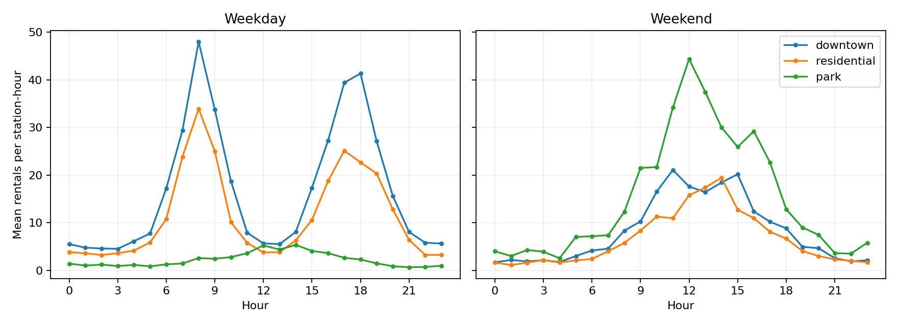
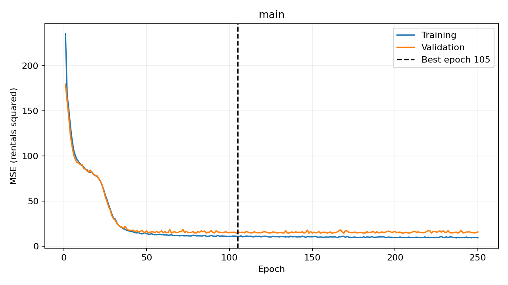
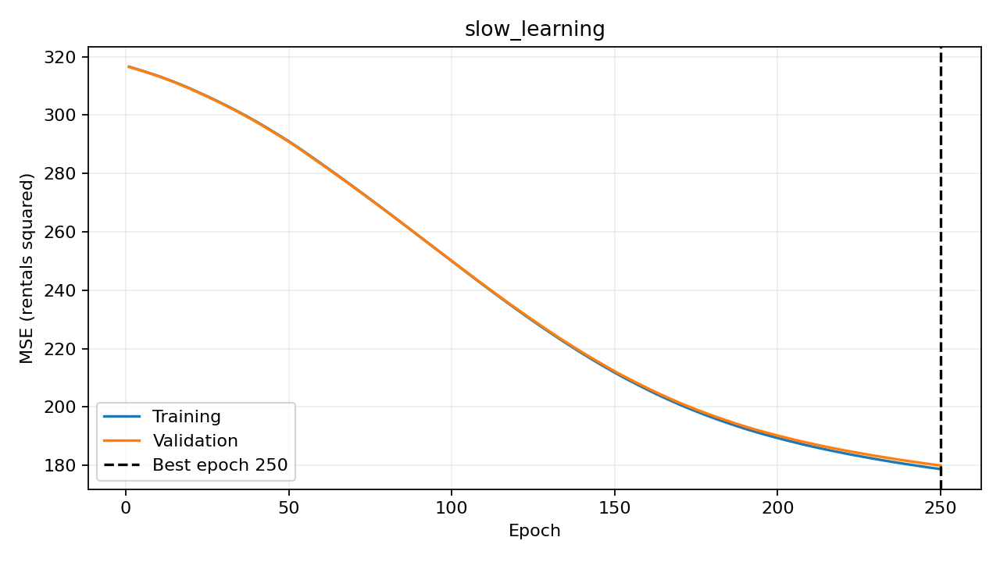
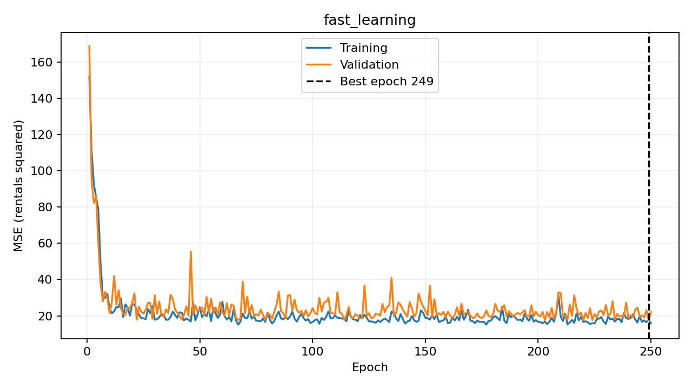
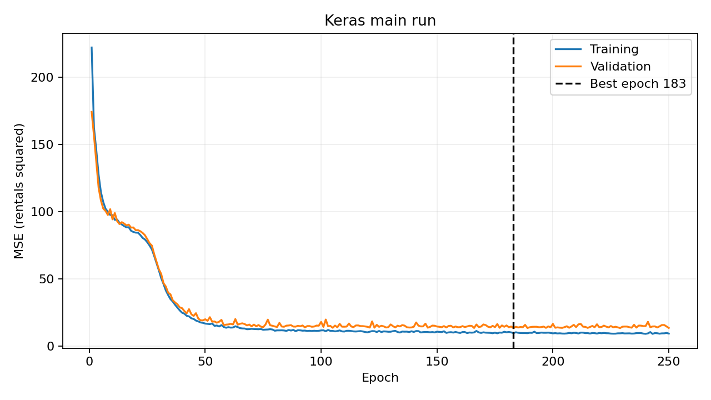

# Lakeshore Bike Demand: the same model in PyTorch and Keras

## What it does

This project predicts hourly bike rentals for a station from the hour, weather,
weekend status and station type. It trains the same neural network architecture
in PyTorch and Keras, with a training-mean predictor and linear regression as
reference baselines.

## How to run it

From the repository root, create and activate the Python 3.12 environment:

```bash
conda env create -f environment.yml
conda activate lab08-same-model-twice
```

The environment uses conda-forge and installs the pinned dependencies from
`requirements-dev.txt` and `requirements.txt`. The project uses Keras 3 with
the TensorFlow backend and runs on CPU. The pinned PyTorch CPU wheel targets
Windows and Linux on x86-64.

```bash
python train.py
python train_keras.py
python compare.py
python -m ruff format --check .
python -m ruff check .
python -m pytest
```

If the terminal does not activate Conda, run the same Python commands through
the named environment:

```bash
conda run --no-capture-output -n lab08-same-model-twice python train.py
conda run --no-capture-output -n lab08-same-model-twice python train_keras.py
conda run --no-capture-output -n lab08-same-model-twice python compare.py
```

| Command | Reproduced files |
|---|---|
| `python train.py` | PyTorch histories and learning curves, baseline results, experiments and the training-data demand plot in `reports/` |
| `python train_keras.py` | `reports/history_keras.csv`, `reports/metrics_keras.json`, `reports/learning_curves_keras.png`, and `checkpoints/best_keras.keras` |
| `python compare.py` | `reports/equivalence.txt` and `reports/comparison.csv` |

The reports are included. The binary Keras checkpoint directory is ignored by Git;
the main training command recreates it. The comparison writes its checkpoints
to a temporary directory and cleans them up when it finishes.

## Data and split

`bikes_data.py` is the supplied, unchanged generator. It creates 6,000 synthetic
station-hour rows with seed 2026. The target is `rentals`; the six input columns
are `hour`, `temperature_c`, `rain_mm`, `wind_kph`, `is_weekend` and
`station_type`. The target is never included in the input features.

Two fixed-seed random splits produce 3,600 training rows, 1,200 validation rows
and 1,200 test rows, with disjoint original row indices. Splitting happens before
fitting the scaler or encoder. `StandardScaler` learns means and scales only from
the five numeric training columns. `OneHotEncoder(handle_unknown="ignore")`
learns station categories only from training rows; validation and test rows use
those fitted transformations. The resulting input width is eight. Unknown future
stations receive all-zero station indicators and are outside the training scope.

`RentalsDataset` returns a float32 feature vector of shape `(8,)` and target of
shape `(1,)`. A batch has shapes `(N, 8)` and `(N, 1)`, avoiding accidental
broadcasting in the loss. Only the training DataLoader shuffles. Its own seeded
generator makes the order repeatable, while validation and test keep their order.
The split is appropriate for the supplied independently generated table; it is
not evidence of generalization across real dates or unseen stations.

The exploratory plot uses training rows only. Weekday downtown and residential
demand have morning and evening peaks, while weekend park demand peaks around
midday. One straight-line relationship with hour cannot describe both peaks or
these station-by-weekend interactions.



## Model and training

The main network is `8 → 64 → ReLU → 32 → ReLU → 1`. The last layer is linear:
this is regression in rentals, not classification or a probability. Targets stay
in rental units. We optimize mean squared error (MSE) with Adam, learning rate
0.003, batches of 64 and 250 epochs. MAE is also measured in rentals.

`run_epoch()` calls `model.train()` with gradients when an optimizer is supplied;
otherwise it uses evaluation mode and disables gradients. Every training batch
visibly performs `optimizer.zero_grad()`, a forward pass, MSE calculation,
`loss.backward()` and `optimizer.step()`. Loss and absolute error are accumulated
by row count, so a short final batch has the correct weight.

`fit_network()` logs training MSE, training MAE, validation MSE and validation MAE
for every epoch. It copies the state dictionary whenever validation MSE improves
and restores that independent copy after training. The best epoch is selected by
validation MSE, not by the final epoch or the lowest MAE. Training loss is measured
while weights change within an epoch; validation loss is measured afterward with
fixed weights, so their values are not exactly like-for-like training-set scores.

Python, NumPy and PyTorch use seed 2026. Each run resets initialization and the
training DataLoader generator to that seed, uses CPU execution, one PyTorch thread
and deterministic algorithms. Experiments share the same splits and initial
architecture. Repeated runs on the same software and computer reproduce the
numbers. Another platform may differ in the final digits; `metrics.json` records
the runtime package versions. Reference execution used Python 3.12.14,
torch 2.6.0+cpu, NumPy 2.3.5, pandas 2.2.3, scikit-learn 1.8.0 and
matplotlib 3.10.8.

## Results

Both baselines are fitted on training rows and use the same prepared features and
held-out rows as the network. The mean baseline always predicts the training
target mean, 10.603889 rentals. After all experiment settings and checkpoints were
chosen using validation data, the selected network and the two baselines were
each evaluated once on the test rows. Alternative neural networks were not scored
on the test set, and no settings were changed in response to the test result.

| Model | Validation MAE in rentals | Test MAE in rentals |
|---|---:|---:|
| Training mean | 9.951945 | 9.848395 |
| Linear regression | 9.032177 | 8.762954 |
| Neural network at restored epoch 105 | 2.550627 | 2.421072 |

The linear model improves slightly on a constant but still misses the curved
hourly peaks and interactions visible in the training-data plot. The network
learns these nonlinear patterns and has a substantially lower test MAE. An MAE
of 2.421072 means the average absolute error is about 2.42 rentals per
station-hour on this synthetic test set; it is not an accuracy percentage.
The selected network's test MSE is 12.803972 rentals squared.



The main curve falls quickly, then improves more slowly. Its lowest validation
MSE is 14.150525 at epoch 105. Training MSE continues down to 9.226685 at epoch
250, while final validation MSE is 15.722697. That later gap and lack of sustained
validation improvement suggest mild overfitting after the best checkpoint; the
restored epoch 105 is used for the final result.

## Experiments

Each additional run changes only the learning rate relative to the main run.
All use hidden widths `(64, 32)`, batch size 64, Adam and 250 epochs, with identical
splits and reset seeds. The final network is chosen by the lowest best-checkpoint
validation MSE across these three runs. The main run wins this comparison.

| Run | Learning rate | Best epoch by MSE | Lowest validation MAE during run | Validation MAE at restored best MSE | Final training MSE | Final validation MSE |
|---|---:|---:|---:|---:|---:|---:|
| Main | 0.003 | 105 | 2.497910 | 2.550627 | 9.226685 | 15.722697 |
| Slow learning | 0.00001 | 250 | 8.771483 | 9.135968 | 178.731081 | 179.955205 |
| Fast learning | 0.1 | 249 | 2.827001 | 2.902485 | 15.823998 | 22.059230 |

MSE is in rentals squared; MAE is in rentals. The lowest validation MAE and the
MAE at the minimum-MSE checkpoint can occur at different epochs, because MSE
penalizes large errors more strongly. The final-loss columns describe epoch 250,
before best-weight restoration. `experiments.csv` also records the best MSE.

**Main run:** It learns the main patterns and has the best validation MSE. Later
training brings limited validation benefit and mild overfitting, as described
above. This is the selected configuration.

**Slow learning:** At the same epoch budget, training and validation losses remain
high and close together. The loss is still decreasing at epoch 250. This is
underfitting from insufficient optimization progress at this learning rate,
rather than evidence that the architecture cannot represent the relationship.
It might improve with more epochs, but that was not tested.



**Fast learning:** It learns faster initially but has a noisier validation curve
and a worse best MSE, 17.372640, than the main run. Its best checkpoint is epoch
249, but the next epoch's validation MSE rises to 22.059230. The large learning
rate causes unstable updates; best-weight restoration protects against retaining
that worse final epoch. It does not diverge completely, and the results do not
justify calling it a failure to learn.



## The Keras version

The Sequential network in `keras_model.py` has the same configurable ReLU
hidden layers and one linear output. Both main models have 2,689 trainable
parameters. Keras reads the same float32 features and targets from
`prepare.py`. The loss is MSE and both use Adam, learning rate 0.003, batches
of 64, and 250 epochs. The comparison keeps the data split fixed and pairs
training seeds 2026, 2027, and 2028.

Before training, `compare.py` copies each PyTorch linear layer's weight matrix
into its Keras Dense layer after transposing it, and copies the bias directly.
The check passed on all 1,200 validation rows with `rtol=1e-5`, `atol=1e-6`,
and a maximum absolute prediction difference of **2.98e-08 rentals**.

Keras uses `compile` and `fit`. EarlyStopping restores the weights at the lowest
validation MSE; patience is 250 so it does not shorten the comparison.
ModelCheckpoint saves the best model to disk. The seed-2026 run restored epoch
183, with validation MSE 13.3981 and test
MAE 2.4714. The plot and CSV record the complete training run.



Each final model is scored once on the test rows. The wall-clock time includes
model setup and fitting, including Keras checkpoint writes, and excludes final
scoring. Reference timing was measured on a Linux x86-64 AMD EPYC CPU. It will
vary across runs and machines.

| Framework | Seed | Best epoch | Validation MAE | Test MAE | Seconds |
|---|---:|---:|---:|---:|---:|
| PyTorch | 2026 | 105 | 2.5506 | 2.4211 | 12.79 |
| Keras | 2026 | 183 | 2.4846 | 2.4714 | 18.74 |
| PyTorch | 2027 | 198 | 2.4772 | 2.5234 | 11.60 |
| Keras | 2027 | 250 | 2.5507 | 2.4141 | 17.79 |
| PyTorch | 2028 | 159 | 2.5694 | 2.5838 | 11.50 |
| Keras | 2028 | 125 | 2.5942 | 2.5011 | 18.77 |

Mean test MAE across seeds was **2.5094** for PyTorch and
**2.4622** for Keras. The difference is small, and the lower-error
framework varied by seed. See [COMPARISON.md](COMPARISON.md) for the recommendation
and the remaining differences in the training setup.

## Tests

The test suite covers the original PyTorch preparation, network, and training
loop as well as Keras output shape, parameter counts for three architectures,
prediction equivalence, shared rows, small-batch memorization, saving and
reloading, best-weight restoration, and seeded repeatability. An additional
square-kernel test verifies that omitting the transpose changes predictions.

## Limitations

These are invented rows from one fixed generator, not observations from an actual
bike-share system. The held-out rows share its assumptions and station categories;
the scores do not establish performance in another city, season or real station.
The model does not see holidays, events, available bikes, docking capacity,
station location, recent demand or forecast-weather uncertainty.

The output is a point estimate and can be fractional or negative because the
required final layer is linear. Metrics use raw predictions with no clipping or
rounding. A real operational system would need a justified treatment of negative
counts and uncertainty before deployment.

Three learning-rate settings with one seed are a limited experiment, not a full
hyperparameter search or an uncertainty estimate. There are no repeated-split
confidence intervals or assessments of rare conditions. Planners should not
automatically move bikes, assume enough stock exists, or treat a prediction as a
guaranteed rental count. Real data and operational constraints must be evaluated
before using this model for dispatch decisions.
